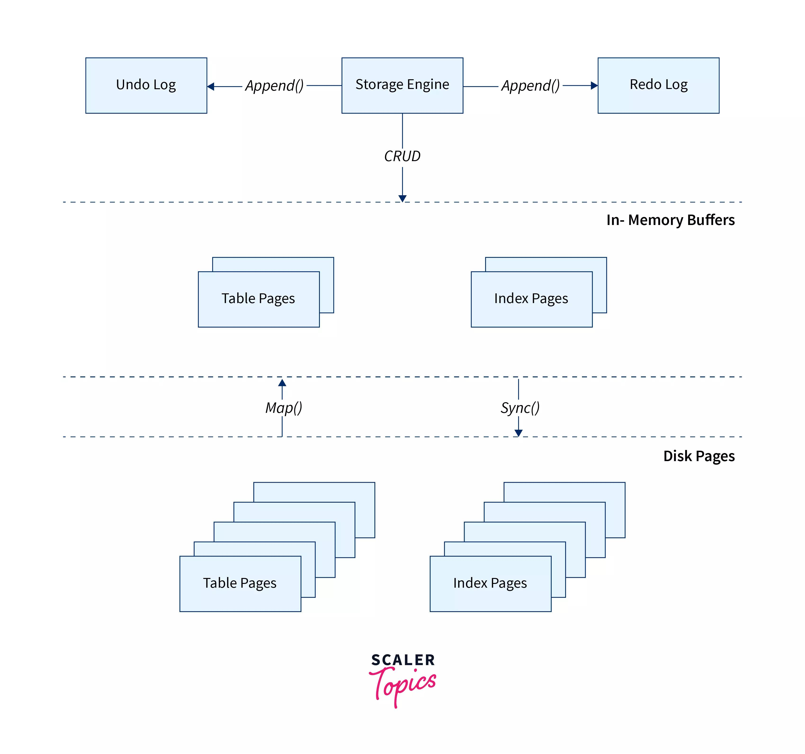
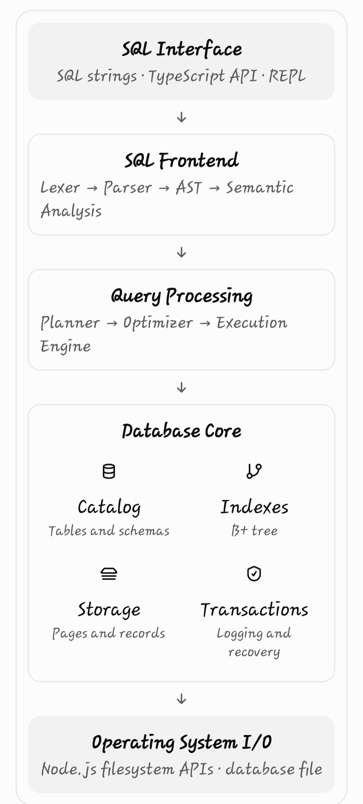

### Holu Database

Open source database with a new take on underlying technologies, observability, performance, and practicality.

The most important modules of a SQL database are:

<ol>
    <li>SQL parser</li>
    <li>query planner</li>
    <li>storage engine</li>
    For more info about how a <strong>storage engine</strong> works with other parts of the database, have a look at the diagram below: 
    
     
    <li>indexing</li>
    <li>transaction manager</li>
    <li>execution engine</li>
</ol>

## Architecture

We're following a modular architecture that separates `SQL compilation`, `execution`, `storage`,
 and `caching` into different modules.

My plan is to support a small yet reasonable subset of SQL for the alpha version of **HoluDB**. This is the
plan I have come up with so far:

`Data types` |	INTEGER, TEXT, REAL, BOOLEAN, NULL 
`Schema` |	CREATE TABLE, DROP TABLE 
`Writes` |	INSERT, UPDATE, DELETE 
`Reads` |	SELECT, WHERE, ORDER BY, LIMIT 
`Constraints` |	PRIMARY KEY, NOT NULL, UNIQUE 
`Storage` |	Custom binary database file 
`Indexes` |	Initially none; later B+ tree 
`Transactions` |	Initially basic atomic operations; later full transactions 
`Joins` |	Later: INNER JOIN, then other join types 
`Durability` |	File persistence, followed by a write-ahead log